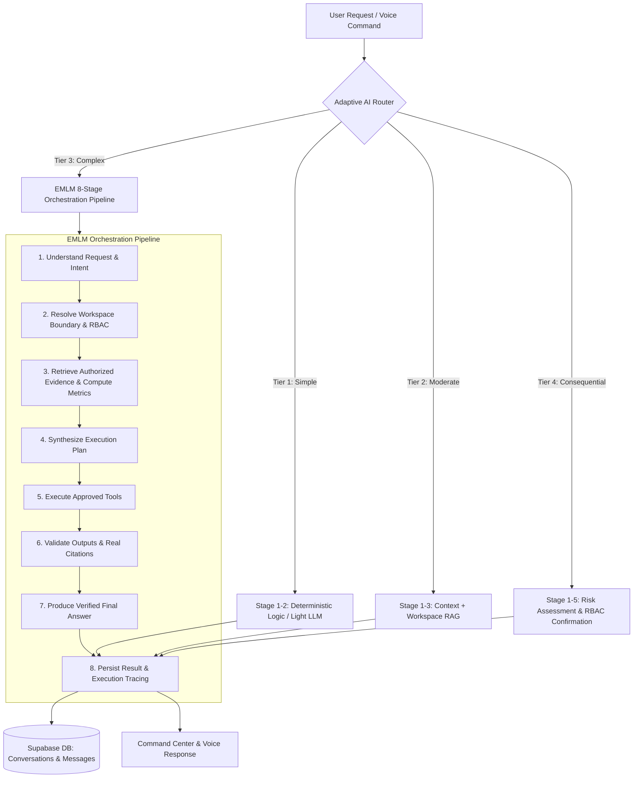
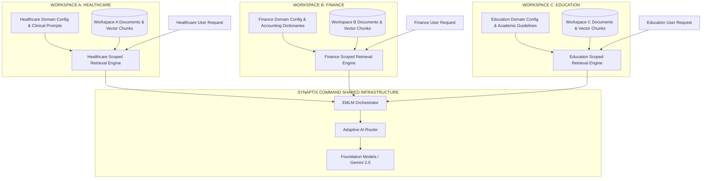

# SYNAPTIX COMMAND — Enterprise AI Intelligence & Operations Platform

SYNAPTIX COMMAND is a multi-workspace enterprise intelligence platform featuring grounded document RAG, deep analytics modeling, governed action orchestration, and voice control powered by Google Gemini and Supabase.

---

## 1. System Architecture



### The Four Core Engines
1. **Knowledge Engine**: Multi-format ingestion (PDF, XLSX, CSV, DOCX), OCR parsing, sliding-window chunking, and isolated vector embeddings.
2. **Intelligence Engine**: Adaptive 4-Tier AI Router, Gemini 2.5 Flash / Pro model management, and EMLM 8-stage pipeline orchestration.
3. **Action Engine**: Sandboxed agent workflows, scheduled cron pipelines, automated verification checks, and dry-run execution simulations.
4. **Governance Engine**: Two-Person Rule sign-offs for consequential actions, 4-tier risk classification, cryptographically grounded evidence grading (G0/G1/G2), and immutable SOC2 Type II audit logging.

### The Six Operational Stages
1. **Understand**: Natural language intent classification and boundary detection.
2. **Organize**: Domain segmentation, semantic vector memory clustering, and entity relationship extraction.
3. **Reason**: Multi-dimensional variance modeling, predictive forecasting, and causal graph traversal.
4. **Act**: Governed operational changes, workflow executions, and system mutations.
5. **Verify**: Cryptographic citation grounding, zero-hallucination verification gate, and audit registration.
6. **Evolve**: Adaptive baseline learning, precedent cataloging, and operational metric refinement.

---

## 2. Multi-Domain, Workspace-Isolated RAG Architecture

SYNAPTIX COMMAND implements a strict multi-tenant, workspace-isolated RAG architecture where each workspace maintains its own independently configured domain knowledge base.



### Key RAG Isolation Principles
1. **Zero Cross-Workspace Fallback**: If a query has no matching documents in the active workspace, the engine returns an explicit empty state with `hasSufficientEvidence: false`. It never falls back to or leaks data from another workspace.
2. **Metadata Preservation**: All chunks preserve `workspace_id`, `domain_id`, `document_id`, `chunk_id`, `content_hash`, `embedding_model`, `knowledge_version`, `evidence_grade`, and source coordinates.
3. **Domain Understanding**: Built-in specialized terminology dictionaries and compliance frameworks for Healthcare (HIPAA/FDA), Finance (SOX/GAAP), Education (FERPA), Manufacturing (ISO 9001), Research (GLP), and Business Strategy, plus custom domain registration.
4. **Backend-Enforced Isolation**: Scoped at the store and repository level (`ragStore.getDocument(id, wsId)`, `ragStore.getChunksByWorkspace(wsId)`). Frontend-only filtering is prohibited.

---

## 3. Repository Structure

```text
Synaptix/
├── apps/
│   └── web/                                  # Primary React 18 + Vite frontend & backend service
│       ├── public/
│       │   └── assets/                       # Static brand logos and imagery
│       ├── server/ (removed -> src/server/)  # Consolidated into single canonical server package
│       ├── src/
│       │   ├── components/                   # Modular UI & Feature Components
│       │   │   ├── actions/                  # Governed action modals, preview, step-up auth
│       │   │   ├── analytics/                # SVG charts, drill-down modals, insight cards
│       │   │   ├── auth/                     # AuthCard, LoginForm, SignupForm, ForgotPasswordModal
│       │   │   ├── command-center/           # Prompt input, dynamic results, reasoning timeline
│       │   │   ├── dashboard/                # Redesigned Enterprise Intelligence Dashboard
│       │   │   │   ├── canvas/               # Consolidated dashboard builder (AiAssist, Canvas, Inspector)
│       │   │   │   ├── ActivityChart.tsx     # SVG AI activity line/area chart
│       │   │   │   ├── AgentOperations.tsx   # Workflow pipelines & execution telemetry
│       │   │   │   ├── AnalyticsSection.tsx  # Multi-tab analytics container
│       │   │   │   ├── DashboardEmptyState.tsx# Clean honest empty state
│       │   │   │   ├── DashboardHeader.tsx   # Contextual greeting, date picker, status pills
│       │   │   │   ├── DashboardPage.tsx     # Master Dashboard orchestrator
│       │   │   │   ├── DashboardSkeleton.tsx # Layout-matched shimmer skeleton
│       │   │   │   ├── DateRangeSelector.tsx # 5-way time horizon controller (7D, 30D, QTD, YTD, All)
│       │   │   │   ├── GovernanceOverview.tsx# Risk-tier distribution & pending approvals
│       │   │   │   ├── KnowledgeOverview.tsx # Ingestion status & format breakdown
│       │   │   │   ├── MetricCard.tsx        # RAF animated count-up KPI card
│       │   │   │   ├── RecentActivity.tsx    # Chronological activity stream
│       │   │   │   ├── types.ts              # Dashboard type definitions
│       │   │   │   └── WorkflowChart.tsx     # SVG stacked bar execution trend chart
│       │   │   ├── documents/                # RAG documents panel, vector chunk inspector
│       │   │   ├── evidence/                 # Cryptographic evidence cards & citation chain view
│       │   │   ├── knowledge/                # Semantic knowledge graph & entity drawer
│       │   │   ├── landing/                  # Enterprise marketing landing page
│       │   │   ├── layout/                   # PageContainer, PageContent, PageHeader
│       │   │   ├── notifications/            # Notification center drawer
│       │   │   ├── problems/                 # Anomaly triage cards & investigation drawer
│       │   │   ├── search/                   # Global search modal across all workspace domains
│       │   │   ├── settings/                 # Profile, security, and preference pages
│       │   │   ├── ui/                       # 35 Reusable Radix UI & design tokens components
│       │   │   └── voice/                    # Voice command HUD & waveform
│       │   ├── data/                         # Typed mock fixtures & benchmark domain data
│       │   ├── design-system/                # AppShell, Sidebar, tokens, and navigation shell
│       │   ├── lib/                          # Core Domain Engines & Integrations
│       │   │   ├── ai/                       # EMLM Orchestrator, AI Router, Conversation Persistence
│       │   │   ├── gemini/                   # Server-side Gemini service & client SDK
│       │   │   ├── rag/                      # Ingestion, Chunking, Embeddings, TF-IDF, Vector Store
│       │   │   ├── supabase/                 # Supabase Auth, client config, and session state
│       │   │   └── voice/                    # VoiceEngine, STT, TTS, intent router, skill registry
│       │   ├── modules/                      # Domain Module Top-Level Views
│       │   │   ├── ActionsModule.tsx         # Governed Actions module
│       │   │   ├── AnalyticsModule.tsx       # Analytics & BI Engine
│       │   │   ├── AuditModule.tsx           # Audit Trail module
│       │   │   ├── CommandModule.tsx         # AI Command Center
│       │   │   ├── DashboardsModule.tsx      # Custom Dashboards canvas builder
│       │   │   ├── DocumentsModule.tsx       # Documents forwarder (UploadsDataModule)
│       │   │   ├── EvidenceModule.tsx        # Evidence Explorer module
│       │   │   ├── KnowledgeModule.tsx       # Knowledge Graph module
│       │   │   ├── ProblemsModule.tsx        # Problem Resolution module
│       │   │   ├── SettingsModule.tsx        # Domain Settings module
│       │   │   ├── UnifiedDashboardModule.tsx# Unified Dashboard view (Overview, Analytics, Dashboards, Problems)
│       │   │   ├── UploadsDataModule.tsx     # Documents & Data Ingestion module
│       │   │   └── WorkflowsModule.tsx       # Agent Workflows & Automation
│       │   ├── server/                       # Standalone Node.js HTTP backend & Vite API plugin
│       │   │   ├── standalone.ts             # Production HTTP API service (Render / standalone)
│       │   │   └── vitePlugin.ts             # Vite dev server middleware
│       │   ├── services/                     # Persistent profile storage & avatar caching
│       │   ├── types/                        # Global workspace, evidence, audit, search types
│       │   ├── App.tsx                       # Master Application Shell & Router
│       │   ├── index.css                     # Enterprise Tailwind 4 design system & animations
│       │   └── main.tsx                      # React root entry point
│       └── test/                             # Vitest unit & integration test suites
├── scripts/                                  # Data ingestion & inventory CLI utilities
│   ├── evaluate_dataset.ts                   # Retrieval accuracy benchmark runner
│   ├── inventory_dataset.ts                  # Test pack manifest generator
│   └── rag_engine.ts                         # Standalone RAG CLI wrapper
├── supabase/
│   └── migrations/                           # PostgreSQL DDL migrations with RLS policies
├── synaptix_test_data/                       # Validated corporate datasets (Finance, Healthcare, etc.)
├── .env.example                              # Reference environment configuration
├── package.json                              # Monorepo workspaces configuration
└── README.md                                 # Technical documentation
```

---

## 3. Environment Configuration

Copy `.env.example` to `.env.local` (and `apps/web/.env.local`):

```bash
# Supabase Authentication & Database
NEXT_PUBLIC_SUPABASE_URL=https://mctckddnapqlbqxqydcj.supabase.co
VITE_SUPABASE_URL=https://mctckddnapqlbqxqydcj.supabase.co
NEXT_PUBLIC_SUPABASE_PUBLISHABLE_KEY=your_supabase_anon_key
VITE_SUPABASE_ANON_KEY=your_supabase_anon_key

# Google Gemini API Integration (Server-Side Backend Only)
GEMINI_API_KEY=your_gemini_api_key
GEMINI_MODEL=gemini-2.5-flash

# ElevenLabs Voice Integration (Optional Server-Side Backend Only)
ELEVENLABS_API_KEY=your_elevenlabs_api_key
ELEVENLABS_VOICE_ID=21m00Tcm4TlvDq8ikWAM
```

> **Security Guarantee**: `GEMINI_API_KEY` and `ELEVENLABS_API_KEY` are strictly backend environment variables and are never bundled into client JavaScript.

---

## 4. Development & Build Commands

```bash
# Install root dependencies
npm install

# Start Vite dev server with integrated API middleware
npm run dev

# Build frontend production bundle
npm run build:web

# Build backend server
npm --prefix apps/web run build:server

# Build all (Frontend + Server)
npm --prefix apps/web run build:all

# Start production API server
npm run start:api

# Run Vitest test suite
npm test
```

---

## 6. Testing & Verification

The test suite covers:
- Multi-domain workspace-isolated RAG architecture (Healthcare, Finance, Education).
- Zero-trust workspace isolation and zero-leakage cross-boundary retrieval.
- Multi-domain terminology expansion, query understanding, and reciprocal rank fusion reranking.
- RESTful HTTP backend RAG API endpoints (`/api/workspaces/:ws/rag/*`, `/api/workspaces/:ws/documents/*`).
- Automated isolation verification check (`validateIsolation`).
- Independent document ingestion pipelines with SHA-256 idempotency and staged replacement.
- Adaptive AI Router (4 policy tiers) and EMLM 8-stage reasoning execution.
- Conversation persistence, idempotency, and bounded context generation.
- Supabase authentication flows, session handling, and avatar storage.
- Voice engine intent recognition, deterministic routing, and skill execution.
- Redesigned Dashboard components, date range controllers, and evidence distributions.

```bash
npm test
```
Result: **15 test files passed, 127 tests passed (100% pass rate).**
