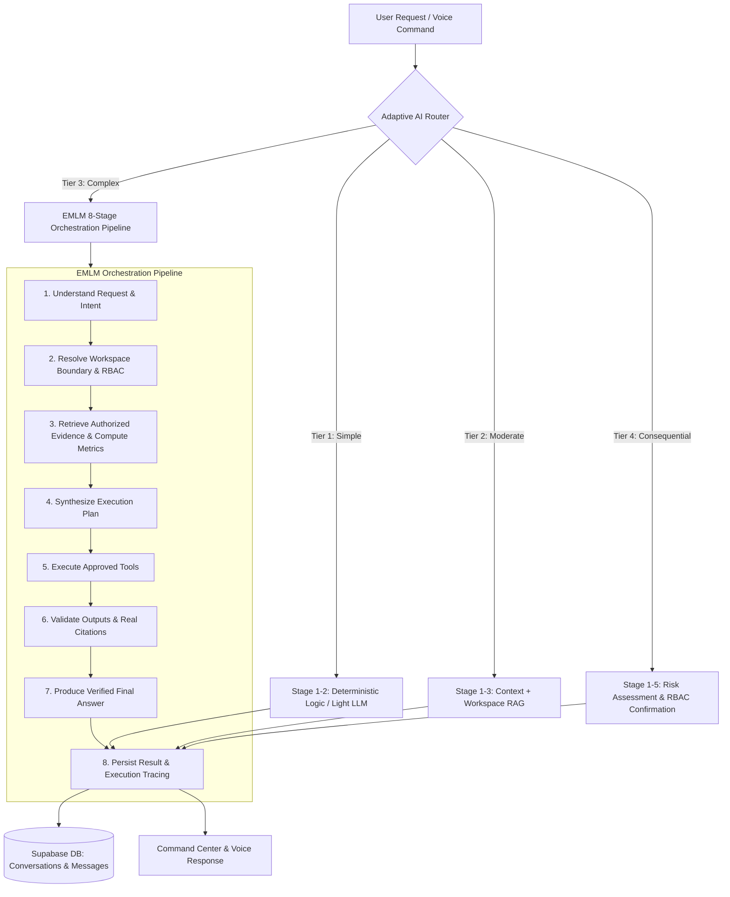

# SYNAPTIX COMMAND — Enterprise AI Intelligence & Operations Platform

SYNAPTIX COMMAND is a multi-workspace enterprise intelligence platform featuring grounded document RAG, deep analytics modeling, governed action orchestration, and voice control powered by Google Gemini and Supabase.

---

## 1. Architecture Overview



---

## 2. EMLM (Enterprise Multi-Layer Mediation) Orchestration

**EMLM** is an enterprise orchestration framework that coordinates query understanding, context assembly, authorized workspace retrieval, model selection, structured validation, tool selection/permission checks, multi-stage reasoning, citation verification, and durable audit persistence.

### The 8 Bounded Reasoning Stages
1. **UNDERSTAND_REQUEST**: Parses intent, semantic entities, and parameters.
2. **RESOLVE_WORKSPACE_BOUNDARY**: Enforces zero-trust workspace tenancy and checks user RBAC permissions.
3. **RETRIEVE_EVIDENCE_AND_METRICS**: Executes authorized RAG vector retrieval and deterministic calculations.
4. **GENERATE_STRUCTURED_PLAN**: Synthesizes a step-by-step resolution plan for complex inquiries.
5. **EXECUTE_APPROVED_TOOLS**: Invokes verified application capabilities (analytics calculations, anomaly scanners, dashboard generators).
6. **VALIDATE_CITATIONS_AND_EVIDENCE**: Cross-references claims against real document chunks to eliminate hallucinations.
7. **PRODUCE_FINAL_ANSWER**: Compiles the grounded response with citations and risk tier annotations.
8. **PERSIST_AND_AUDIT_EXECUTION**: Durably saves conversation state, messages, tokens, and latency to Supabase.

---

## 3. Adaptive AI Router (4-Tier Policy Engine)

Every incoming query is routed based on complexity, required tools, data sensitivity, and risk:

| Tier | Classification | Description & Strategy | Example Queries |
| :--- | :--- | :--- | :--- |
| **Tier 1** | `TIER_1_SIMPLE` | Deterministic logic or lightweight generation with zero RAG overhead. | *"hello"*, *"what is synaptix"*, *"go home"* |
| **Tier 2** | `TIER_2_MODERATE` | Gemini + conversation context + authorized RAG evidence retrieval. | *"What is our pediatric triage policy?"* |
| **Tier 3** | `TIER_3_COMPLEX` | Full 8-stage EMLM orchestration pipeline + analytics math + multi-doc synthesis. | *"Investigate root cause of Q3 revenue variance and anomaly correlation"* |
| **Tier 4** | `TIER_4_CONSEQUENTIAL` | Governed action preview, policy verification, and mandatory human RBAC sign-off. | *"Modify permissions for user X"*, *"Approve requisition $42,500"* |

---

## 4. Environment Configuration

Copy `.env.example` to `.env.local` (and `apps/web/.env.local`):

```bash
# Supabase Authentication & Database
NEXT_PUBLIC_SUPABASE_URL=https://mctckddnapqlbqxqydcj.supabase.co
VITE_SUPABASE_URL=https://mctckddnapqlbqxqydcj.supabase.co
NEXT_PUBLIC_SUPABASE_PUBLISHABLE_KEY=your_supabase_anon_key
VITE_SUPABASE_ANON_KEY=your_supabase_anon_key

# Google Gemini API Integration (Server-Side Backend Only)
GEMINI_API_KEY=your_gemini_api_key
GEMINI_MODEL=gemini-2.5-flash

# ElevenLabs Voice Integration (Optional Server-Side Backend Only)
ELEVENLABS_API_KEY=your_elevenlabs_api_key
ELEVENLABS_VOICE_ID=21m00Tcm4TlvDq8ikWAM
```

> **Security Guarantee**: `GEMINI_API_KEY` and `ELEVENLABS_API_KEY` are strictly backend environment variables and are never bundled into client JavaScript.

---

## 5. Database Migrations

Apply the migration scripts in `supabase/migrations/`:
- `20261010_initial_auth_and_workspaces.sql`: Creates `profiles`, `workspaces`, and `workspace_memberships` with RLS.
- `20261010_conversations_and_messages.sql`: Creates `conversations` and `messages` tables with chronological indexes and user-isolated RLS policies.

---

## 6. Running the Application

### Development Server
```bash
# Root install
npm install

# Start Vite dev server with integrated API middleware
npm --prefix apps/web run dev
```

The web application will be accessible on `http://localhost:3000`.

### Production Build
```bash
npm --prefix apps/web run build
```

---

## 7. Testing & Verification

Run the comprehensive Vitest test suite covering RAG ingestion, Supabase auth, AI routing, EMLM pipeline, and conversation persistence:

```bash
npm --prefix apps/web test -- --run
```
