# SYNAPTIX COMMAND — Full UI Architecture & Page Specification

This document details the complete user interface architecture, navigation pathways, component hierarchies, interaction states, and page-by-page specifications of the **SYNAPTIX COMMAND** enterprise platform.

---

## Table of Contents

1. [High-Level Information Architecture](#1-high-level-information-architecture)
2. [Global Application Shell & Navigation](#2-global-application-shell--navigation)
3. [Global Floating Overlays & Modals](#3-global-floating-overlays--modals)
4. [Page 1: Public Enterprise Landing Page (`#landing` / `#overview`)](#4-page-1-public-enterprise-landing-page)
5. [Page 2: Enterprise Authentication & Onboarding (`#login` / `#signup`)](#5-page-2-enterprise-authentication--onboarding)
6. [Page 3: Workspace Hub / Homepage (`#home`)](#6-page-3-workspace-hub--homepage)
7. [Page 4: Workspace Shell & Domain Overview (`#workspace/:id/overview`)](#7-page-4-workspace-shell--domain-overview)
8. [Page 5: Global Search Module (`#workspace/:id/search`)](#8-page-5-global-search-module)
9. [Page 6: Command Center Module (`#workspace/:id/command`)](#9-page-6-command-center-module)
10. [Page 7: Documents & Data Ingestion Module (`#workspace/:id/documents`)](#10-page-7-documents--data-ingestion-module)
11. [Page 8: Knowledge Graph Module (`#workspace/:id/knowledge`)](#11-page-8-knowledge-graph-module)
12. [Page 9: Analytics Engine Module (`#workspace/:id/analytics`)](#12-page-9-analytics-engine-module)
13. [Page 10: Dashboards Module (`#workspace/:id/dashboards`)](#13-page-10-dashboards-module)
14. [Page 11: Problem Resolution Module (`#workspace/:id/problems`)](#14-page-11-problem-resolution-module)
15. [Page 12: Workflows & Automation Module (`#workspace/:id/workflows`)](#15-page-12-workflows--automation-module)
16. [Page 13: Governed Actions Module (`#workspace/:id/actions`)](#16-page-13-governed-actions-module)
17. [Page 14: Evidence Explorer Module (`#workspace/:id/evidence`)](#17-page-14-evidence-explorer-module)
18. [Page 15: Audit Trail Module (`#workspace/:id/audit`)](#18-page-15-audit-trail-module)
19. [Page 16: Workspace Domain Settings (`#workspace/:id/settings`)](#19-page-16-workspace-domain-settings)
20. [Page 17: User Profile, Security & Preferences (`#settings/*`)](#20-page-17-user-profile-security--preferences)

---

## 1. High-Level Information Architecture

SYNAPTIX COMMAND utilizes a state-driven URL hash router (`window.location.hash`) synchronized with persistent user sessions and Supabase authentication.

```mermaid
flowchart TD
    A[Unauthenticated Visitor] -->|Landing / Marketing| B[Landing Page: #landing]
    A -->|Sign In / Sign Up| C[Auth Page: #login / #signup]
    
    C -->|Authenticate| D[Workspace Hub: #home]
    
    D -->|Select Workspace| E[Workspace Shell: #workspace/:id/*]
    D -->|User Profile Menu| F[Global User Settings: #settings/*]
    
    subgraph Workspace Modules
        E --> M1[Overview: #workspace/:id/overview]
        E --> M2[Global Search: #workspace/:id/search]
        E --> M3[Command Center: #workspace/:id/command]
        E --> M4[Knowledge Graph: #workspace/:id/knowledge]
        E --> M5[Documents & Data: #workspace/:id/documents]
        E --> M6[Analytics Engine: #workspace/:id/analytics]
        E --> M7[Dashboards: #workspace/:id/dashboards]
        E --> M8[Problem Resolution: #workspace/:id/problems]
        E --> M9[Workflows & Automation: #workspace/:id/workflows]
        E --> M10[Governed Actions: #workspace/:id/actions]
        E --> M11[Evidence Explorer: #workspace/:id/evidence]
        E --> M12[Audit Trail: #workspace/:id/audit]
        E --> M13[Domain Settings: #workspace/:id/settings]
    end
    
    subgraph Global User Settings
        F --> S1[Profile Settings: #settings/profile]
        F --> S2[Security & Sessions: #settings/security]
        F --> S3[Preferences & Theme: #settings/preferences]
    end
```



### Routing & Guard Table

| Route Hash | Screen / View | Access Level | Description |
| :--- | :--- | :--- | :--- |
| `#landing`, `#overview` | Public Landing Page | Public | Product marketing, interactive feature preview, capabilities showcase |
| `#login`, `#signup` | Authentication Page | Public | Enterprise email/password login, registration, Google SSO via Supabase |
| `#home` | Workspace Hub | Protected | Post-login launcher, workspace cards, quick actions, recent activity |
| `#workspace/:id/:module` | Workspace Module Shell | Protected | Context-scoped module views for an active enterprise domain boundary |
| `#settings/profile` | User Profile Settings | Protected | Personal identity, avatar upload, organization name, role assignment |
| `#settings/security` | Security Settings | Protected | Password update, MFA configuration, active sessions, revocation |
| `#settings/preferences` | User Preferences | Protected | Theme (Dark/Light/HC), density, reduced motion, hub layout visibility |

---

## 2. Global Application Shell & Navigation

When navigating inside any workspace domain, the UI is wrapped by the **`AppShell`** component (`apps/web/src/design-system/components/AppShell.tsx`), providing unified navigation, workspace switching, search, and user controls.

```
+---------------------------------------------------------------------------------------------------------+
| [Logo] SYNAPTIX  [Workspace Switcher: Finance v] | [Search (Cmd+K)]  (Mic)  [Notif (3)]  [User Profile v]|
+--------------------------------------------------+------------------------------------------------------+
| [<- Hub] [Finance Boundary: Finance]             |                                                      |
|                                                  |                                                      |
| - Overview                                       |                                                      |
| - Global Search                                  |                                                      |
| - Command Center                                 |                                                      |
| - Knowledge Graph                                |                                                      |
| - Documents & Data (128)                         |                    MODULE CONTENT                    |
| - Analytics Engine                               |                                                      |
| - Dashboards (4)                                 |                (Active module view)                  |
| - Problem Resolution                             |                                                      |
| - Workflows & Automation                         |                                                      |
| - Governed Actions (2)                           |                                                      |
| - Evidence Explorer                              |                                                      |
| - Audit Trail                                    |                                                      |
| - Domain Settings                                |                                                      |
|                                                  |                                                      |
| [<< Collapse Sidebar]                            |                                                      |
+--------------------------------------------------+------------------------------------------------------+
```

### Components of AppShell

1. **Top Header Bar (`shell-top-nav`)**:
   - **Brand Anchor**: Interactive `SynaptixLogo` rendering SVG icon with wordmark.
   - **Workspace Switcher (`WorkspaceSwitcher`)**: Dropdown showing current workspace name, accent color pill, domain type, and list of other authorized workspaces with document counts. Includes a `+ Create Workspace` launcher.
   - **Global Search Button**: Shows search icon and `⌘K` / `Ctrl+K` keybadge that triggers the Global Search Modal.
   - **Voice Command Assistant Trigger**: Microphone button with pulsing ring indicator.
   - **Notifications Menu (`NotificationPanel`)**: Displays badge counter with unread notifications. Dropdown lists items with severity color, workspace source, and timestamp, with "Mark all read" and direct jump links.
   - **User Profile Dropdown**: Displays avatar (or initials avatar fallback), user name, role, with links to Profile Settings, Security Settings, Preferences, and "Sign Out".

2. **Collapsible Sidebar (`Sidebar.tsx`)**:
   - **Return to Hub Button**: Top button navigating back to `#home` ("Workspace Hub").
   - **Active Boundary Pill**: Displays workspace color indicator, boundary type, and workspace title.
   - **13 Navigation Module Items**:
     - *Overview* (Icon: `LayoutDashboard`)
     - *Global Search* (Icon: `Search`)
     - *Command Center* (Icon: `Bot`)
     - *Knowledge Graph* (Icon: `BrainCircuit`)
     - *Documents & Data* (Icon: `FileText`, Badge: Document Count)
     - *Analytics Engine* (Icon: `LineChart`)
     - *Dashboards* (Icon: `BarChart3`, Badge: Dashboard Count)
     - *Problem Resolution* (Icon: `AlertTriangle`)
     - *Workflows & Automation* (Icon: `Workflow`)
     - *Governed Actions* (Icon: `CheckSquare`, Badge: Pending Actions with alert color)
     - *Evidence Explorer* (Icon: `ShieldCheck`)
     - *Audit Trail* (Icon: `History`)
     - *Domain Settings* (Icon: `Settings`)
   - **Collapse Toggle**: Bottom button toggling between 260px expanded state and 64px icon-only rail with tooltips.

---

## 3. Global Floating Overlays & Modals

### 3.1 Global Search Modal (`GlobalSearchModal.tsx`)
- **Invocation**: Triggered anywhere via `Cmd+K` / `Ctrl+K`, top bar search, or sidebar navigation.
- **Search Input**: Full-width auto-focused input with live debounced search across all 9 asset types: Documents, Datasets, Entities, Knowledge Claims, Dashboards, Problems, Workflows, Governed Actions, and Audit Events.
- **Workspace Scope Filter**: Dropdown allowing filtering across "All Workspaces" or specific domain boundaries.
- **Permission Guard**: Redacts and excludes cross-workspace unauthorized assets, displaying a security badge: *"Tenant boundary isolation enforced"*.
- **Result Item Actions**: Click navigates directly to target workspace and module with a toast notification.

### 3.2 Voice Command HUD (`VoiceCommandHud.tsx`)
- **Placement**: Floating bottom-center heads-up display.
- **States**: `IDLE` -> `LISTENING` -> `PROCESSING_TRANSCRIPT` -> `CLASSIFYING` -> `EXECUTING` -> `VERIFYING` -> `SPEAKING` -> `ERROR`.
- **Controls**:
  - Live animated waveform & mic toggle button.
  - Transcript preview showing interim and finalized speech.
  - Text-to-speech speaker toggle (`Mute` / `Unmute`).
  - Close HUD button.
- **Capabilities**: Hands-free workspace navigation, module switching, sub-tab selection, back/forward history traversal, and natural-language knowledge queries with vocal playback.

### 3.3 Toast Notification System (`Toast.tsx`)
- **Placement**: Bottom-right floating stack.
- **Behavior**: Animated entrance, 4.5-second auto-dismiss, manual dismiss close button (`X`).

---

## 4. Page 1: Public Enterprise Landing Page

- **Route**: `#landing` / `#overview`
- **File**: `apps/web/src/components/landing/LandingPage.tsx`
- **Purpose**: High-converting, enterprise presentation explaining Synaptix Command's boundary isolation, G1 grounded evidence engine, and human-in-the-loop governance.

```
+------------------------------------------------------------------------------------+
| [Logo] SYNAPTIX | ENTERPRISE     [Platform] [Capabilities] [Preview] [Journey] [Sign In] [Get Started] |
+------------------------------------------------------------------------------------+
|  [Animated Hero Background: Smooth particle lines]                                 |
|  (•) Synaptix Command 3.2 • Governed Enterprise Intelligence                       |
|  Autonomous Intelligence with Strict Boundary Governance                           |
|  [ Access Command Console -> ]   [ Sign In with SSO / Credentials ]                |
|  [3 Enterprise Domains]  |  [100% G1 Grounded Evidence]  |  [Two-Person Rule Auth] |
+------------------------------------------------------------------------------------+
|  PRODUCT PREVIEW SHOWCASE (Tabbed Browser Mockup):                                 |
|  [ [Layers] Workspace Hub ]  [ [FileCheck2] Evidence Chain ]  [ [Lock] Governed Actions ] |
|  +------------------------------------------------------------------------------+  |
|  | (•) (•) (•)  https://synaptix.enterprise.internal/command/console            |  |
|  | Active Workspace Boundaries: Finance, BioPharma, Infrastructure              |  |
|  +------------------------------------------------------------------------------+  |
+------------------------------------------------------------------------------------+
|  GOVERNED CAPABILITIES ACROSS EVERY LAYER (4 Grid Cards):                          |
|  [Workspace Domain Boundaries]  [Grounded Evidence Engine]                         |
|  [Governed Action Framework]    [Interactive Command & Analytics]                  |
+------------------------------------------------------------------------------------+
|  THE THREE-PHASE SYNAPTIX JOURNEY:                                                 |
|  [01: Ingest & Domain Seg] -> [02: Synthesize & Verify Evidence] -> [03: Governed Execution]|
+------------------------------------------------------------------------------------+
|  STRICT GOVERNANCE WITHOUT HAND-WAVY GUARANTEES:                                   |
|  - Human-in-the-Loop Authority    | Governance Specification:                      |
|  - Immutable Audit Trail          | - Access Model: RBAC                           |
|  - Zero Data Mixture Between Ten. | - Evidence: G1 Cryptographic Hash             |
+------------------------------------------------------------------------------------+
|  READY TO COMMAND YOUR ENTERPRISE INTELLIGENCE?                                    |
|  [ Create Workspace Account ]  [ Sign In to Existing Workspace ]                   |
+------------------------------------------------------------------------------------+
|  Enterprise Footer with Platform, Governance, and Access Links                     |
+------------------------------------------------------------------------------------+
```

### Sections & Interactive Elements

1. **Sticky Enterprise Header**:
   - Brand logo with `ENTERPRISE` badge.
   - Smooth scroll anchor links: `#overview`, `#capabilities`, `#preview`, `#workflow`, `#governance`.
   - Action buttons: `Sign In` (opens Login), `Get Started` (opens Signup).
   - Responsive hamburger mobile menu drawer.

2. **Cinematic Hero (`AnimatedHeroBackground.tsx`)**:
   - Status badge: *"Synaptix Command 3.2 • Governed Enterprise Intelligence"*.
   - Headline: *"Autonomous Intelligence with Strict Boundary Governance"*.
   - CTA group with primary "Access Command Console" and secondary "Sign In with SSO / Credentials".
   - Operational Metrics Bar: 3 isolated domains, 100% G1 grounded citations, Two-Person Rule authorization.

3. **Interactive Product Preview Showcase**:
   - Live tab switcher between 3 simulated views:
     - **Workspace Hub Tab**: Shows interactive mock domain boundary cards (Finance, BioPharma, Infrastructure Core) with authorization badges and doc counts.
     - **Evidence Chain & Verification Tab**: Displays verified citation `SYN-EV-94183`, ground truth confidence score (99.4%), and zero-hallucination verification checklist.
     - **Governed Actions Tab**: Shows high-risk operational action with dual sign-off requirement and step-up auth trigger.

4. **Capabilities Section**:
   - 4 domain capability cards featuring icon boxes, descriptions, and feature checklists.

5. **Operational Methodology Workflow**:
   - Three-phase progressive journey: `01 Ingest & Domain Segmentation` -> `02 Synthesize & Verify Evidence` -> `03 Authorize & Governed Execution`.

6. **Governance & Auditability Section**:
   - Architecture breakdown highlighting human-in-the-loop authority, immutable audit trail, and zero data leakage.
   - Technical specification card detailing RBAC, G1 evidence standards, and automated rollback snapshots.

7. **CTA Banner & Enterprise Footer**:
   - Conversion buttons to login or register.
   - Comprehensive footer with legal copyright, compliance notices, and categorized links.

---

## 5. Page 2: Enterprise Authentication & Onboarding

- **Route**: `#login` / `#signup`
- **Files**: `apps/web/src/components/auth/AuthPage.tsx`, `AuthCard.tsx`, `LoginForm.tsx`, `SignupForm.tsx`, `BrandPanel.tsx`
- **Purpose**: Secure enterprise login, account creation, and SSO integration with Supabase.

```
+----------------------------------------------------+---------------------------------------------+
| LEFT PANEL: AUTHENTICATION CARD                    | RIGHT PANEL: BRAND SHOWCASE                 |
|                                                    |                                             |
| [<- Back to Landing Page]                          |  SYNAPTIX COMMAND                           |
|                                                    |  Governed Multi-Domain Intelligence         |
| [ Sign In ]  |  [ Create Account ]                 |                                             |
|                                                    |  - Strict Workspace Boundary Isolation      |
| [ Continue with Google (Supabase SSO) ]            |  - Cryptographically Grounded Evidence      |
|                                                    |  - Tiered Human-in-the-Loop Sign-Off        |
| -------------- or enter credentials -------------- |                                             |
|                                                    |  "Autonomous reasoning with cryptographic   |
| Email Address: [ corporate@enterprise.com       ]  |   verification and explicit authorization." |
| Password:      [ ***************            (Eye) ]|                                             |
|                                                    |  [Security Status: SOC2 Type II Certified]  |
| [x] Remember session on this machine               |                                             |
|                                                    |                                             |
| [ Sign In to Command Console ]                     |                                             |
|                                                    |                                             |
| [ Forgot your password? ]                          |                                             |
+----------------------------------------------------+---------------------------------------------+
```

### Components & Form Elements

1. **Authentication Mode Switcher**:
   - Two-tab selector between `Sign In` and `Create Account`.
   - "Back to Landing Page" button for unauthenticated visitors.

2. **SSO Button**:
   - "Continue with Google" button with Google logo, triggering Supabase OAuth flow with loading spinners and error banners.

3. **Login Form (`LoginForm.tsx`)**:
   - Email input with regex validation.
   - Password input with toggleable show/hide password eye icon.
   - "Remember me" checkbox (persists session email in `localStorage`).
   - "Forgot password?" trigger modal opening `ForgotPasswordModal`.

4. **Registration Form (`SignupForm.tsx`)**:
   - Full Name, Corporate Email, Organization / Tenant Name.
   - Password & Confirm Password with live password strength meter (Length, Mixed Case, Numbers, Symbols).
   - Domain role selection dropdown (Admin, Analyst, Auditor, Operator).
   - Enterprise Terms & Privacy acceptance checkbox.

5. **Forgot Password Modal (`ForgotPasswordModal.tsx`)**:
   - Clean modal input requesting user email.
   - Generates recovery link with confirmation toast notification.

6. **Brand Panel (`BrandPanel.tsx`)**:
   - High-contrast visual column featuring platform value propositions, active boundary count, and enterprise compliance badges (SOC2 Type II, HIPAA Compliant, SAML 2.0).

---

## 6. Page 3: Workspace Hub / Homepage

- **Route**: `#home`
- **Files**: `apps/web/src/components/HomePage.tsx`, `HeroCommandArea.tsx`, `WorkspaceGrid.tsx`, `RecentActivitySection.tsx`, `QuickActionsSection.tsx`
- **Purpose**: Post-login command console hub presenting all authorized enterprise workspace boundaries, cross-domain recent activity, and quick operational launchers.

```
+---------------------------------------------------------------------------------------------------------+
| [Logo] SYNAPTIX | WORKSPACE HUB        [Filter Workspaces...]  (Mic)  [Notif (3)]  [Alex Vance (Admin) v]|
+---------------------------------------------------------------------------------------------------------+
| HERO / COMMAND AREA:                                                                                    |
|   Ask Synaptix across your enterprise domains...                                       (Mic) [Command ->]|
|   [Isolation Notice: e.g. "Select a workspace to execute revenue analysis in Finance"]                  |
+---------------------------------------------------------------------------------------------------------+
| YOUR WORKSPACES (3 Columns Grid):                                                                       |
|                                                                                                         |
| +-------------------------+ +-------------------------+ +-------------------------+                     |
| | [TrendingUp] FINANCE    | | [FlaskConical] RESEARCH | | [Activity] HEALTHCARE   |                     |
| | Financial intelligence, | | Scientific synthesis,   | | Patient outcome analyt. |                     |
| | revenue modeling & audit| | paper analysis & data   | | & HIPAA evidence models |                     |
| | 128 Docs | 12 Datasets  | | 84 Docs | 18 Datasets   | | 210 Docs | 32 Datasets  |                     |
| | (•) Authorized          | | (•) Authorized          | | (•) Authorized          |                     |
| +-------------------------+ +-------------------------+ +-------------------------+                     |
| +-------------------------+ +-------------------------+ +-------------------------+                     |
| | [GradCap] EDUCATION     | | [Briefcase] BUSINESS    | | [Plus] CREATE WORKSPACE |                     |
| | Learning insights &     | | Market positioning &    | | Establish a new role-   |                     |
| | student outcome modeling| | strategic execution     | | isolated security domain|                     |
| +-------------------------+ +-------------------------+ +-------------------------+                     |
+---------------------------------------------------------------------------------------------------------+
| RECENT ACTIVITY (Full-Width Timeline):                                                                  |
| [Check] Finance      | Analysis Run       | Revenue analysis completed              | 5 minutes ago     |
| [Check] Research     | Dataset Upload     | clinical_trial_v4.csv ingested          | 20 minutes ago    |
| [Clock] Healthcare   | Compliance Audit   | Executive compliance audit generated    | 1 hour ago        |
+---------------------------------------------------------------------------------------------------------+
| QUICK ACTIONS:                                                                                          |
| [ (Sparkles) Focus Command ]      [ (Upload) Ingest Documents ]      [ (+ Folder) New Workspace ]       |
+---------------------------------------------------------------------------------------------------------+
| Footer: SYNAPTIX COMMAND v2.4 • Enterprise Security SAML 2.0 Compliant • System Operational (All Active) |
+---------------------------------------------------------------------------------------------------------+
```

### Components & Page Sections

1. **Top Navigation Header (`TopNavigation.tsx`)**:
   - Workspace search filter input.
   - Global Cmd+K trigger.
   - Voice assistant mic button.
   - Notification menu & User profile drawer.

2. **Hero Command Area (`HeroCommandArea.tsx`)**:
   - Universal natural-language command input with microphone button.
   - **Boundary Isolation Detector**: If a user enters a query mentioning specific domain data (e.g., *"revenue growth"* or *"clinical trial"*), it highlights the matching workspace card and displays an **Isolation Notice**: *"Your command requires domain context. Please select the appropriate workspace to continue."*

3. **Workspace Grid (`WorkspaceGrid.tsx`)**:
   - Displays authorized workspace cards (3 cards per row).
   - Workspaces: **Finance**, **Research**, **Healthcare**, **Education**, **Business Strategy**, **Custom Operations**.
   - Card Metrics: Domain icon, domain tag, document count, dataset count, dashboard count, pending action counter, last activity timestamp, and boundary color accent.
   - **Create Workspace Card**: Dedicated tile opening `CreateWorkspaceModal`.

4. **Create Workspace Modal (`CreateWorkspaceModal.tsx`)**:
   - Fields: Workspace Name, Domain Category (Finance, Healthcare, Research, Education, Business, Custom), Description, Accent Color picker, Authorization permissions.

5. **Recent Activity Section (`RecentActivitySection.tsx`)**:
   - Chronological table showing domain, activity type, description, status badge, and timestamp.
   - Clicking any item navigates directly to that workspace boundary.

6. **Quick Actions Section (`QuickActionsSection.tsx`)**:
   - Three quick launcher buttons: "Focus Command Input", "Upload Data" (prompts workspace boundary selection), and "New Workspace".

---

## 7. Page 4: Workspace Shell & Domain Overview

- **Route**: `#workspace/:id/overview`
- **File**: `apps/web/src/components/WorkspaceOverviewScreen.tsx`
- **Purpose**: Dedicated overview dashboard for a selected workspace domain. Displays metric counters, synthesized domain insights, scoped recent activity, and quick action tiles.

```
+---------------------------------------------------------------------------------------------------------+
| Workspaces > Finance                                                                                    |
| [TrendingUp] Finance Workspace   [Finance Domain]   [(ShieldCheck) Strict Domain Isolation]             |
| Your domain intelligence and operations workspace.                                                     |
+---------------------------------------------------------------------------------------------------------+
| [Sparkles] Ask Synaptix about finance workspace...                                    (Mic) [Command ->]|
| Boundary context active: Finance Workspace • Press Enter to execute                                     |
+---------------------------------------------------------------------------------------------------------+
| WORKSPACE SUMMARY (6 Live Animated Counter Cards):                                                      |
| +----------------+ +----------------+ +----------------+ +----------------+ +----------------+ +----+  |
| | Documents      | | Datasets       | | Knowledge Items| | Dashboards     | | Open Problems  | |Pending|
| | 128            | | 12             | | 1,854          | | 4              | | 2 [Alert]      | | 2  |  |
| | Ingested/index | | Connected sch. | | Triples/entity | | Active visual  | | Anomalies flag | |Apprv |
| +----------------+ +----------------+ +----------------+ +----------------+ +----------------+ +----+  |
+---------------------------------------------------------------------------------------------------------+
| DOMAIN INSIGHTS (Synthesized Intelligence Cards):                                                       |
| +-----------------------------------------+ +-----------------------------------------+                 |
| | [Trend] [Severity: Positive]    10m ago | | [Anomaly] [Severity: Warning]   25m ago |                 |
| | Revenue Trend Changed                   | | New Anomaly Detected                    |                 |
| | Domain metric baseline updated (+4.2%)  | | Unusual variance pattern flagged in     |                 |
| | Confidence: 96%  [View Trend Analysis ->| | Confidence: 92%   [Inspect Anomaly ->]  |                 |
| +-----------------------------------------+ +-----------------------------------------+                 |
+---------------------------------------------------------------------------------------------------------+
| RECENT ACTIVITY (Finance Scope):           | QUICK ACTIONS:                                             |
| [Check] Analysis Run | Revenue analyzed    | [ (Upload) Upload Data -> Ingest docs & datasets ]         |
| [Check] Data Ingest  | Q3 ledger loaded    | [ (LineChart) Analyze Data -> Run query & models ]         |
| [Check] Action Appr  | Budget cap verified | [ (Layout) Create Dashboard -> Build domain view ]        |
|                                            | [ (Workflow) Create Workflow -> Automate pipeline ]        |
|                                            | [ (Sparkles) Ask Synaptix -> Focus command input ]         |
+---------------------------------------------------------------------------------------------------------+
```

### Components & Features

1. **Breadcrumb & Header**: Shows path `Workspaces > [Workspace Name]`, domain pill, and *"Strict Domain Isolation"* security badge.
2. **Context-Bounded Command Bar**: Direct input scoped exclusively to the active workspace with microphone voice input.
3. **6 Summary Metric Counters (`AnimatedCounter`)**:
   - Numbers count up smoothly upon page mount.
   - Cards: *Documents*, *Datasets*, *Knowledge Items*, *Dashboards*, *Open Problems* (highlight border), *Pending Actions* (highlight border).
   - Clicking any metric jumps directly to that module.
4. **Domain Insights Grid**: 4 cards showing categorized synthesized intelligence (Trend, Anomaly, Document, Approval) with confidence meters (92% - 99%) and direct module action links.
5. **Lower Grid**:
   - Left Column: Workspace-specific recent activity list with status icons.
   - Right Column: 5 quick action tiles with colored icon badges and arrow indicators.

---

## 8. Page 5: Global Search Module

- **Route**: `#workspace/:id/search`
- **File**: `apps/web/src/modules/GlobalSearchModule.tsx`
- **Purpose**: Full-page search console for finding documents, datasets, knowledge items, dashboards, problems, workflows, actions, and audit records with strict boundary filtering.

```
+---------------------------------------------------------------------------------------------------------+
| GLOBAL SEARCH & DISCOVERY                                                                               |
| Search across authorized enterprise knowledge, models, and governed actions.                           |
+---------------------------------------------------------------------------------------------------------+
| [ Search query or keywords...                                                                      (X) ]|
| Scope: [ All Workspaces v ] | Type: [ All Types v ] | Grade: [ G1 / G2 Verified v ] | Owner: [ All v ]  |
+---------------------------------------------------------------------------------------------------------+
| [Tenant Isolation: 3 Cross-Boundary Assets Redacted]                                                   |
| Showing 24 authorized results matching "revenue"                                                       |
+---------------------------------------------------------------------------------------------------------+
| CATEGORIZED RESULTS:                                                                                    |
|                                                                                                         |
| V DOCUMENTS (8)                                                                                         |
|   [FileText] FY2026_Enterprise_Revenue_Synthesis.csv | Finance Workspace | Grade A+ (G1) | 3.4 MB       |
|   [FileText] Q3_Financial_Forecast_Model_v4.xlsx     | Finance Workspace | Grade A+ (G1) | 1.8 MB       |
|                                                                                                         |
| V ANALYTICS & DASHBOARDS (3)                                                                            |
|   [BarChart3] FY2026 Executive Performance Dashboard | Finance Workspace | Published by Alex Vance      |
|                                                                                                         |
| V GOVERNED ACTIONS (2)                                                                                  |
|   [CheckSquare] ACT-2026-901: Reallocate Q4 Budget Thresholds in Oracle ERP | Risk: Critical            |
+---------------------------------------------------------------------------------------------------------+
```

### Key Elements & Controls

- **Omni-Filter Bar**: Filters by Workspace, Asset Type (Documents, Datasets, Entities, Knowledge, Dashboards, Problems, Workflows, Actions, Audit), Evidence Grade (G2, G1, G0, Contradicted), and Author/Owner.
- **Security Boundary Counter**: Calculates and displays redacted/unauthorized results to demonstrate boundary enforcement without leaking data.
- **Grouped Results Accordion**: Groups matching results into collapsable categories with type badges, metadata tags, and direct jump handlers.

---

## 9. Page 6: Command Center Module

- **Route**: `#workspace/:id/command`
- **Files**: `apps/web/src/modules/CommandModule.tsx`, `CommandInputArea.tsx`, `DynamicResultView.tsx`, `EvidencePanel.tsx`, `ReasoningProgress.tsx`
- **Purpose**: The primary interactive AI interface. Employs the 4-tier Adaptive AI Router, executes the 8-stage EMLM orchestration pipeline, renders multi-modal answers, and displays grounded cryptographic evidence.

```
+---------------------------------------------------------------------------------------------------------+
| COMMAND CENTER — [Finance Workspace]                                      [Clear Chat] [Export Session]|
+---------------------------------------------------------------------------------------------------------+
| CONVERSATION VIEW (Left 65%)                       | EVIDENCE & GROUNDING PANEL (Right 35%)             |
|                                                    |                                                    |
| [User]: Analyze revenue from 2010–2026             | [ShieldCheck] Ground Truth Verification: G1 Grounded|
|                                                    |                                                    |
| [Synaptix AI] [Tier 2 Moderate RAG] [98% Conf]     | Evidence Hash:                                     |
| Revenue analysis for Finance shows strong          | sha256-8f9a2b1c4e7d3a5b6c8d9e0f1a...               |
| growth from $12.4M in 2010 to $86.5M in 2022.      |                                                    |
| Predictive models project $124.2M for FY2026.      | Primary Sources (2):                               |
|                                                    | 1. Finance_2010_2026_Revenue_Synthesis.csv         |
| +------------------------------------------------+ | 2. Q3_Forecast_Model_v4.xlsx (Sheet 2, B14)        |
| | TIME-SERIES REVENUE CHART                      | |                                                    |
| |  $124M |                      * 2026 (Est)     | | Extracted Knowledge Triples:                       |
| |   $86M |               * 2022                  | | - [Finance] -> (has_revenue_model) -> [18.4% CAGR] |
| |   $48M |        * 2018                         | | - [Q3 Forecast] -> (predicts_growth) -> [$124.2M] |
| |   $12M | * 2010                                | |                                                    |
| +------------------------------------------------+ | Zero-Hallucination Gate: Passed (Strict Anchor)   |
|                                                    |                                                    |
| [User]: Find anomalies in this dataset             | Risk Classification:                               |
| [Synaptix AI]: Scanned 12 tabular datasets...      | Low Risk (Read-Only Analytical Synthesis)          |
+----------------------------------------------------+----------------------------------------------------+
| 8-STAGE REASONING PIPELINE:                                                                             |
| [✓ Understand] > [✓ Boundary RBAC] > [✓ Retrieve] > [✓ Plan] > [✓ Tools] > [✓ Citations] > [✓ Answer]   |
+---------------------------------------------------------------------------------------------------------+
| COMMAND INPUT AREA:                                                                                     |
| Model: [ Gemini 2.5 Flash v ] | Routing: [ Tier 2 Moderate (RAG) v ] | Temperature: [ 0.2 ]             |
| [ Ask anything about finance documents, anomalies, or forecasts...             ]  (Mic)  [ Submit -> ] |
| Suggestions: "Analyze revenue trends" | "Check duplicate invoices" | "Verify EMEA customs drift"       |
+---------------------------------------------------------------------------------------------------------+
```

### Components & Features

1. **Command Input Area (`CommandInputArea.tsx`)**:
   - Multi-line natural-language prompt input with speech-to-text microphone button.
   - Model Selector (Gemini 2.5 Flash, Gemini 1.5 Pro).
   - Adaptive Routing Tier indicator (Tier 1 Simple, Tier 2 Moderate RAG, Tier 3 Complex EMLM, Tier 4 Governed Action).
   - Quick-prompt suggestions pills.

2. **Reasoning Progress Timeline (`ReasoningProgress.tsx`)**:
   - Displays real-time progress through the 8 EMLM reasoning stages with animated loading spinners and completion checkmarks.

3. **Dynamic Result View (`DynamicResultView.tsx`)**:
   - Multi-modal response renderer supporting:
     - Formatted Markdown text explanations.
     - Interactive SVG charts (Line, Bar, Area).
     - Filterable tabular ledgers.
     - Code / query blocks with copy button.
     - Action suggestion cards with one-click preview buttons.

4. **Evidence Panel (`EvidencePanel.tsx`)**:
   - Displays the cryptographic SHA-256 evidence hash.
   - Verified source file citations with page/sheet coordinates.
   - Ground truth confidence score (0–100%).
   - Extracted knowledge graph triples.
   - Zero-hallucination verification checklist.

---

## 10. Page 7: Documents & Data Ingestion Module

- **Route**: `#workspace/:id/documents`
- **Files**: `apps/web/src/modules/DocumentsModule.tsx`, `DocumentDetailsDrawer.tsx`, `DatasetImportModal.tsx`, `ConnectSourceModal.tsx`, `RagMemoryInspector.tsx`, `RagDocumentsPanel.tsx`
- **Purpose**: Manage documents, upload raw data, inspect RAG vector memory chunks, and verify document integrity.

```
+---------------------------------------------------------------------------------------------------------+
| DOCUMENTS & DATA INGESTION — [Finance Workspace]                                                        |
| Ingest files, inspect vector embeddings, and review source extraction confidence.                       |
+---------------------------------------------------------------------------------------------------------+
| View Mode: [ (•) Document Manifest ]  [ ( ) RAG Vector Memory Inspector ]                               |
| Controls:  [+ Upload Files]  [+ Import Dataset (CSV/XLSX)]  [+ Connect Cloud Source]                     |
+---------------------------------------------------------------------------------------------------------+
| FILTERS BAR:                                                                                            |
| [Search documents...] | Format: [ All v ] | Status: [ Ready v ] | Grade: [ Grade A+ v ]                 |
+---------------------------------------------------------------------------------------------------------+
| DOCUMENTS MANIFEST TABLE:                                                                               |
| [x] | Name                                  | Type | Size   | Status | Evidence | Hash       | Actions  |
| --- | ------------------------------------- | ---- | ------ | ------ | -------- | ---------- | -------- |
| [ ] | FY2026_Enterprise_Revenue_Synthesis   | CSV  | 3.4 MB | Ready  | Grade A+ | sha256:8f9a| [View][x]|
| [ ] | Q3_Financial_Forecast_Model_v4        | XLSX | 1.8 MB | Ready  | Grade A+ | sha256:44d1| [View][x]|
| [ ] | EMEA_Logistics_Audit_2021             | PDF  | 8.2 MB | Ready  | Grade A+ | sha256:7b3c| [View][x]|
+---------------------------------------------------------------------------------------------------------+
| DOCUMENT DETAILS DRAWER (Slides out from right on row selection):                                       |
| - Filename, file type, byte size, ingestion timestamp.                                                  |
| - AI-generated document summary.                                                                        |
| - Vector Chunks breakdown (chunk index, character count, token estimate).                               |
| - Extracted entities & metadata tags.                                                                   |
| - Full raw text / tabular content preview.                                                              |
| - Delete document / Re-index button.                                                                    |
+---------------------------------------------------------------------------------------------------------+
```

### Components & Features

1. **Dual View Mode Switcher**:
   - **Document Manifest**: High-level table of all uploaded documents and connected datasets.
   - **RAG Vector Memory Inspector (`RagMemoryInspector.tsx`)**: Deep inspect tool showing raw vector chunks, similarity distances, cosine search testing, and index health.
2. **Action Modals**:
   - `DatasetImportModal`: CSV/Excel ingestion with schema mapping and column type validation.
   - `ConnectSourceModal`: Cloud data connectors (Google Drive, AWS S3, Snowflake, Oracle ERP).
3. **Document Details Drawer (`DocumentDetailsDrawer.tsx`)**: Comprehensive slide-out drawer displaying chunk breakdowns, extracted entities, and content verification hashes.

---

## 11. Page 8: Knowledge Graph Module

- **Route**: `#workspace/:id/knowledge`
- **Files**: `apps/web/src/modules/KnowledgeModule.tsx`, `KnowledgeGraph.tsx`, `EntityDetailDrawer.tsx`, `RagKnowledgeSearchPanel.tsx`
- **Purpose**: Visualize organizational intelligence as an interactive semantic graph of boundaries, entities, metrics, audits, and governance policies.

```
+---------------------------------------------------------------------------------------------------------+
| KNOWLEDGE GRAPH — [Finance Workspace]                               [Reset Layout] [Export Triples]     |
+---------------------------------------------------------------------------------------------------------+
| INTERACTIVE GRAPH CANVAS (Left 65%):               | ENTITY DETAIL DRAWER (Right 35%):                  |
|                                                    |                                                    |
|           (n2: Vendor Operations)                  | Selected Node: Gross Margin Variance               |
|                 \                                  | Type: Metric Node                                  |
|                  \                                 | Status: G1 Verified (100% Grounded)                |
|      (n1: Finance Workspace Boundary)              |                                                    |
|           /       |       \                        | Associated Claims (3):                             |
|          /        |        \                       | 1. "Gross margin accelerated +4.2% in Q3"          |
|         /         |         \                      | 2. "Supply chain surcharges impacted EMEA hub"     |
|   (n4: KPMG)   (n3: Margin)  (n5: SAML Policy)     |                                                    |
|                                                    | Connected Knowledge Triples:                       |
| [Legend: (Blue) Boundary  (Orange) Entity          | - [Finance] -> (tracks_metric) -> [Gross Margin]   |
|          (Green) Metric   (Purple) Audit           | - [EMEA Hub] -> (exhibits_anomaly) -> [-14.2% Cont]|
|          (Teal) Governance Policy ]                |                                                    |
|                                                    | Supporting Source Documents:                       |
| Controls: [Zoom In] [Zoom Out] [Center View]       | - FY2026_Enterprise_Revenue_Synthesis.csv          |
+----------------------------------------------------+----------------------------------------------------+
| VERIFIED CLAIMS REGISTER (Bottom Section):                                                              |
| [Search claims or entities...]                                                                          |
| - Claim: "EMEA distribution hubs suffered 14.2% margin contraction during 2019-2021" [G1 Verified] (98%)|
| - Claim: "Unallocated vendor requisitions exceeded $42,500 threshold" [G1 Verified] (94%)               |
+---------------------------------------------------------------------------------------------------------+
```

### Components & Features

1. **Interactive SVG/Canvas Graph (`KnowledgeGraph.tsx`)**:
   - Nodes represent domain boundaries, organizational entities, business metrics, compliance audits, and governance policies.
   - Interactive zoom, pan, and node drag-and-drop.
   - Hover highlights connected relationship edges.
2. **Entity Detail Drawer (`EntityDetailDrawer.tsx`)**:
   - Opens when clicking any graph node.
   - Displays incoming/outgoing connections, associated claims, source citations, and verification status.
3. **Claims Register**:
   - Searchable list of all atomic claims extracted from workspace documents with confidence ratings.

---

## 12. Page 9: Analytics Engine Module

- **Route**: `#workspace/:id/analytics`
- **Files**: `apps/web/src/modules/AnalyticsModule.tsx`, `AnalyticsCharts.tsx`, `InsightPanel.tsx`, `DataDrillDownModal.tsx`
- **Purpose**: Deep exploratory BI analytics featuring time-series trends, category comparisons, scatter relationships, stacked composition drivers, and AI-driven insights.

```
+---------------------------------------------------------------------------------------------------------+
| ANALYTICS ENGINE — [Finance Workspace]                                                                  |
| Multi-dimensional telemetry, anomaly detection, and automated variance modeling.                       |
+---------------------------------------------------------------------------------------------------------+
| CONTROL BAR:                                                                                            |
| Dataset: [ FY2026 Enterprise Operational Ledger v ] | Date: [ 2010 – 2026 v ] | Metric: [ Gross Margin % v ]|
| Natural Language Query: [ "Compare EMEA vs North America margin acceleration" ]         (Mic) [ Analyze ]|
+---------------------------------------------------------------------------------------------------------+
| SUB-TABS:                                                                                               |
| [ Overview ]  [ Trends ]  [ Comparisons ]  [ Anomalies ]  [ Relationships ]  [ Drivers ]  [ Data ]     |
+---------------------------------------------------------------------------------------------------------+
| ACTIVE VIEW (e.g. Trends Tab):                     | AI SYNTHESIZED INSIGHT PANEL:                      |
| +------------------------------------------------+ | [Sparkles] Key Strategic Observations:             |
| | TIME-SERIES LINE CHART                         | |                                                    |
| |  50% |   *----*                                | | 1. Severe EMEA Margin Contraction (2019-2021)      |
| |  40% |         \       /--* Current (41.2%)    | |    - Severity: Critical Alert                      |
| |  30% |          *-----* Trough (28.3%)         | |    - Confidence: 98.4%                             |
| |  20% |                                         | |    - Impact: -$42.8M cumulative drift              |
| |      +---------------------------------------  | |    [Drill Down to Ledger Rows ->]                  |
| |        '10  '12  '14  '16  '18  '20  '22  '26  | |                                                    |
| +------------------------------------------------+ | 2. Rebound Acceleration Post-Automation            |
|                                                    |    - Severity: Positive Acceleration               |
|                                                    |    - Confidence: 94.1%                             |
+----------------------------------------------------+----------------------------------------------------+
| DATA DRILL-DOWN MODAL (Opens upon clicking an insight or chart point):                                  |
| Tabular row-level inspection with CSV export and raw ledger audit coordinates.                          |
+---------------------------------------------------------------------------------------------------------+
```

### Components & Interactive Charts

1. **Sub-Tab Architecture**:
   - `overview`: Summary dashboard combining trends, top anomalies, and primary metrics.
   - `trends`: `TimeSeriesLineChart` with anomaly marker pills and hover tooltips.
   - `comparisons`: `CategoryBarChart` displaying baseline vs current variance bars.
   - `anomalies`: Flagged statistical outliers exceeding 2.5 standard deviations.
   - `relationships`: `RelationshipScatterPlot` correlating two metrics with Pearson correlation coefficient.
   - `drivers`: `CompositionStackedBar` showing component contributions over time.
   - `detailed_data`: Full raw tabular ledger with sorting, filtering, and CSV download.
2. **AI Insight Panel (`InsightPanel.tsx`)**:
   - Synthesizes findings with severity tags (Critical, Warning, Positive, Neutral), confidence ratings, and "Drill Down" triggers.
3. **Data Drill-Down Modal (`DataDrillDownModal.tsx`)**:
   - Provides granular cell-level transparency for any selected chart point or insight.

---

## 13. Page 10: Dashboards Module

- **Route**: `#workspace/:id/dashboards`
- **Files**: `apps/web/src/modules/DashboardsModule.tsx`, `DashboardCanvas.tsx`, `WidgetConfigPanel.tsx`, `AiAssistToolbar.tsx`
- **Purpose**: Interactive dashboard workspace supporting drag-and-drop customization, widget inspector configuration, and 7-stage natural language dashboard generation.

```
+---------------------------------------------------------------------------------------------------------+
| DASHBOARDS — [FY2026 Executive Performance & Revenue Trajectory]              [+ Add Widget] [Save]     |
+---------------------------------------------------------------------------------------------------------+
| AI ASSIST TOOLBAR:                                                                                      |
| [ "Build a dashboard showing EMEA logistics costs vs operating margins"             ] [Generate Layout] |
| Pipeline: [✓ Request] > [✓ Interpret] > [✓ Datasets] > [✓ Metrics] > [✓ Visuals] > [✓ Layout] > [Preview]|
+---------------------------------------------------------------------------------------------------------+
| DASHBOARD CANVAS (Left 70%):                       | WIDGET CONFIG INSPECTOR (Right 30%):               |
|                                                    |                                                    |
| +------------------+ +---------------------------+ | Selected: "Gross Margin %" KPI Card                |
| | KPI: MARGIN %    | | KPI: NET REVENUE          | | Widget Title: [ Gross Margin %                   ] |
| | 41.2% (+3.4%)    | | $124.2M (+14.2%)          | | Widget Type:  [ KPI Card                       v ] |
| +------------------+ +---------------------------+ | Width:        [ Third Width (1/3)              v ] |
| +------------------------------------------------+ | Dataset:      [ FY2026 Operational Ledger      v ] |
| | CHART: HISTORICAL MARGIN TRAJECTORY (Line)     | | Metric:       [ Gross Margin %                 v ] |
| | [ Time series chart visual ]                   | | Color Accent: [ Blue #1769E0                   v ] |
| +------------------------------------------------+ |                                                    |
| +------------------------------------------------+ | [ Duplicate Widget ]         [ Delete Widget ]     |
| | TABLE: ANOMALOUS LEDGER TRANSACTIONS           | |                                                    |
| | [ High-risk vendor transactions table ]        | |                                                    |
| +------------------------------------------------+ |                                                    |
+----------------------------------------------------+----------------------------------------------------+
```

### Components & Features

1. **AI Assist Toolbar (`AiAssistToolbar.tsx`)**:
   - Natural language input that automatically determines necessary metrics, charts, and layout structure through 7 stages.
2. **Dashboard Canvas (`DashboardCanvas.tsx`)**:
   - Grid layout supporting 1/3-width, 1/2-width, and full-width widgets.
   - Supported widget types: KPI Card, Time-Series Line, Category Bar, Data Table, Anomaly Alert, and Synthesized Insight.
3. **Widget Config Panel (`WidgetConfigPanel.tsx`)**:
   - Slide-out inspector allowing real-time editing of widget titles, datasets, metrics, visualization types, and color palettes.

---

## 14. Page 11: Problem Resolution Module

- **Route**: `#workspace/:id/problems`
- **Files**: `apps/web/src/modules/ProblemsModule.tsx`, `ProblemCard.tsx`, `ProblemDetailDrawer.tsx`
- **Purpose**: Triage, investigate, and resolve detected operational anomalies, compliance breaches, and margin leaks.

```
+---------------------------------------------------------------------------------------------------------+
| PROBLEM RESOLUTION — [Finance Workspace]                                                                |
| Detected anomalies, operational regressions, and causal investigations.                                |
+---------------------------------------------------------------------------------------------------------+
| KPI SUMMARY CARDS:                                                                                      |
| [Critical: 1 Active]   |   [Attention: 2 Flagged]   |   [Investigation: 3 Underway]   |   [Resolved: 14]|
+---------------------------------------------------------------------------------------------------------+
| CATEGORY TABS:  [ (•) Critical ]   [ Attention ]   [ Investigation ]   [ Resolved ]                     |
| Filters: Search: [ Search problems... ] | Evidence: [ G1 Verified v ] | Status: [ Active v ]            |
+---------------------------------------------------------------------------------------------------------+
| PROBLEM CARDS LIST:                                                                                     |
|                                                                                                         |
| +-----------------------------------------------------------------------------------------------------+ |
| | [AlertTriangle: Critical]  PRB-2019-041                                            Detected: 2019-21| |
| | Gross Margin Contraction Across EMEA Operational Sector                                             | |
| | Impact: -$42.8M Margin Drift (-14.2%) • Evidence Grade: G1 Verified (98.4% Confidence)              | |
| | Affected Metrics: Gross Margin %, EMEA COGS Overhead, Customs Tariff Penalties                      | |
| | [ Inspect Investigation & Evidence -> ]                                                             | |
| +-----------------------------------------------------------------------------------------------------+ |
+---------------------------------------------------------------------------------------------------------+
| PROBLEM DETAIL DRAWER (Slides out from right on problem selection):                                     |
| 1. What Happened: Detailed chronological narrative with empirical data citations.                       |
| 2. Contributing Factors Breakdown:                                                                      |
|    - Logistics Overhead Surcharge (100% Observed Empirical Fact)                                        |
|    - Unhedged Customs Tariffs (88.4% Probable Factor)                                                   |
|    - Vendor Latency Covariance (Pearson r = -0.84 Statistical Correlation)                              |
| 3. Supporting Evidence Cryptographic Hashes (e.g. 0x8a9f42b10e99a110).                                 |
| 4. Linked Documents (PDFs, Spreadsheets).                                                               |
| 5. Action Buttons: [ Propose Governed Action ]  [ Open in Analytics ]                                   |
+---------------------------------------------------------------------------------------------------------+
```

### Components & Features

- **Category Tabs**: Critical, Attention, Investigation, Resolved.
- **Problem Cards (`ProblemCard.tsx`)**: Highlights financial/operational impact, confidence score, and affected metrics.
- **Problem Detail Drawer (`ProblemDetailDrawer.tsx`)**: Dissects causality using a strict 3-tier classification: *Observed Data (Facts)* vs *Possible Factors (Probabilities)* vs *Correlations (Statistical)* to prevent speculative reasoning. Includes direct links to initiate a Governed Action.

---

## 15. Page 12: Workflows & Automation Module

- **Route**: `#workspace/:id/workflows`
- **Files**: `apps/web/src/modules/WorkflowsModule.tsx`, `WorkflowCanvas.tsx`, `WorkflowNode.tsx`, `StepConfigDrawer.tsx`, `DryRunModal.tsx`
- **Purpose**: Visual automation studio for constructing multi-step reasoning and action pipelines with step-up approval gates.

```
+---------------------------------------------------------------------------------------------------------+
| WORKFLOW STUDIO — [Invoice Verification & High-Value Approval]      [Status: Enabled] [Test Run] [Save] |
+---------------------------------------------------------------------------------------------------------+
| AI PROMPT GENERATOR:                                                                                    |
| [ "When an invoice > ₹100,000 is uploaded, scan for duplicates and require Controller signoff" ] [Build]|
+---------------------------------------------------------------------------------------------------------+
| PIPELINE CANVAS:                                                                                        |
|                                                                                                         |
|   +--------------------------+                                                                          |
|   | Step 1: TRIGGER          | -> When document uploaded to Finance workspace                           |
|   +--------------------------+                                                                          |
|                |                                                                                        |
|                v                                                                                        |
|   +--------------------------+                                                                          |
|   | Step 2: DATA EXTRACTION  | -> OCR & parse vendorName, invoiceAmount, taxId                          |
|   +--------------------------+                                                                          |
|                |                                                                                        |
|                v                                                                                        |
|   +--------------------------+                                                                          |
|   | Step 3: CONDITION RULE   | -> If isDuplicate == false AND invoiceAmount > ₹100,000                  |
|   +--------------------------+                                                                          |
|                |                                                                                        |
|                v                                                                                        |
|   +--------------------------+                                                                          |
|   | Step 4: AI REASONING     | -> Scan for pricing drift and abnormal freight surcharges                |
|   +--------------------------+                                                                          |
|                |                                                                                        |
|                v                                                                                        |
|   +--------------------------+                                                                          |
|   | Step 5: GOVERNED APPROVAL| -> Route to Finance Controller for dual authorization                    |
|   +--------------------------+                                                                          |
+---------------------------------------------------------------------------------------------------------+
| STEP CONFIG DRAWER: Configure trigger events, OCR extraction fields, logic expressions, approver roles. |
| DRY RUN MODAL: Step-by-step simulator showing execution traces, condition evaluations, and output logs.  |
+---------------------------------------------------------------------------------------------------------+
```

### Components & Features

1. **Pipeline Canvas (`WorkflowCanvas.tsx` & `WorkflowNode.tsx`)**:
   - Visual step nodes: *Trigger*, *Data Extraction*, *Condition*, *AI Analysis*, *Approval*, and *Action*.
   - Drag or click to reconfigure step sequencing.
2. **Step Config Drawer (`StepConfigDrawer.tsx`)**:
   - Slide-out editor for configuring condition expressions, approver roles, and OCR fields.
3. **Dry Run Modal (`DryRunModal.tsx`)**:
   - Pre-flight test harness simulating a live event, displaying input payloads, execution timings, and conditional branch decisions.

---

## 16. Page 13: Governed Actions Module

- **Route**: `#workspace/:id/actions`
- **Files**: `apps/web/src/modules/ActionsModule.tsx`, `ActionCard.tsx`, `ActionPreviewModal.tsx`
- **Purpose**: Mission-critical action governance console where mutations to external systems (ERPs, cloud infra, ledgers) are inspected, validated, and authorized under human RBAC control.

```
+---------------------------------------------------------------------------------------------------------+
| GOVERNED ACTIONS CONSOLE — [Finance Workspace]                                                          |
| Human-in-the-loop authorization, step-up authentication, and automated rollback snapshots.              |
+---------------------------------------------------------------------------------------------------------+
| RISK TIER CARDS:                                                                                        |
| [Critical: 1 Pending Dual Auth] | [High Risk: 2 Awaiting Review] | [Medium: 4 Executed] | [Low: Auto]   |
+---------------------------------------------------------------------------------------------------------+
| STATUS TABS:                                                                                            |
| [ (•) Pending ]   [ Approved ]   [ Running ]   [ Completed ]   [ Failed ]   [ Rolled Back ]             |
+---------------------------------------------------------------------------------------------------------+
| ACTION CARDS LIST:                                                                                      |
|                                                                                                         |
| +-----------------------------------------------------------------------------------------------------+ |
| | [Lock: Critical Risk]  ACT-2026-901                                             Status: Dual Sign-Off| |
| | Reallocate Q4 Budget Thresholds in Oracle ERP                                                       | |
| | Requested By: Alex Vance (Lead Intelligence Officer) • Target: Oracle ERP Finance, Corporate Vault   | |
| | Changes: UPDATE accounts SET q4_cap = 14500000 WHERE cost_center = "EMEA-DIST-04"                  | |
| | Verification: Cryptographic Dual-Key Ledger Hash (0x8a9f42b10e99a110) • Reversibility: Fully Revers. | |
| | [ Review & Authorize Action -> ]                                                                    | |
| +-----------------------------------------------------------------------------------------------------+ |
+---------------------------------------------------------------------------------------------------------+
| ACTION PREVIEW & APPROVAL MODAL (`ActionPreviewModal.tsx`):                                             |
| 1. Goal Understood & High-Level Plan Summary.                                                           |
| 2. Multi-Step Execution Plan (Step 1: Verify Tariff -> Step 2: Escrow -> Step 3: Mutate ERP).           |
| 3. Affected Systems & Impact Summary.                                                                   |
| 4. Automated Pre-Execution Dry Run Log.                                                                 |
| 5. Rollback Guarantee: Snapshot created before execution.                                               |
| 6. Step-Up Authentication / Dual Sign-Off: Requires password / 2FA confirmation from Senior Officer.   |
| [ Reject Action ]                                                          [ Sign & Execute Action ]    |
+---------------------------------------------------------------------------------------------------------+
```

### Components & Features

1. **Risk Tier Categorization**:
   - `Critical`: Requires Two-Person Rule (Dual Senior Officer authorization) + Step-Up Auth.
   - `High`: Single Senior Officer approval + Step-Up Auth.
   - `Medium`: Analyst approval.
   - `Low`: Automated execution with audit log.
2. **Action Preview & Authorization Modal (`ActionPreviewModal.tsx`)**:
   - Comprehensive safety review displaying target SQL/API mutation payloads, rollback snapshot IDs, cryptographic audit hashes, and password/MFA challenge fields before execution.

---

## 17. Page 14: Evidence Explorer Module

- **Route**: `#workspace/:id/evidence`
- **Files**: `apps/web/src/modules/EvidenceModule.tsx`, `EvidenceCard.tsx`, `OriginalSourceViewerDrawer.tsx`
- **Purpose**: Verify, inspect, and audit all grounded claims, citations, and source documents to ensure zero hallucination across the enterprise.

```
+---------------------------------------------------------------------------------------------------------+
| EVIDENCE EXPLORER — [Finance Workspace]                                 [+ Propose Claim] [Re-verify All]|
| Cryptographic G1/G2 verification ledger and primary source document citations.                          |
+---------------------------------------------------------------------------------------------------------+
| GROUND TRUTH METRIC METER:                                                                              |
| [ Total Claims: 18 ]  |  [ G2 Robust: 6 ]  |  [ G1 Verified: 10 ]  |  [ G0 Inferred: 2 ]  |  [ Contradicted: 0 ]|
+---------------------------------------------------------------------------------------------------------+
| FILTERS BAR:                                                                                            |
| Search: [ Search claims, hashes, or documents... ] | Grade: [ G1 Verified v ] | Confidence: [ > 90% v ]  |
+---------------------------------------------------------------------------------------------------------+
| EVIDENCE CARDS LIST:                                                                                    |
|                                                                                                         |
| +-----------------------------------------------------------------------------------------------------+ |
| | [ShieldCheck] SYN-EV-94183                                           Grade: G1 Cryptographic Verified| |
| | Q3 Liquidity Coverage Ratio Variance (+3.4%)                                        Confidence: 99.4%| |
| | "Synthesized deduction from Tier-1 asset disclosures in filing SEC-10Q filed 2026-09-30, confirmed    | |
| | against treasury internal ledger #TL-9942."                                                         | |
| |                                                                                                     | |
| | Sources (2):                                                                                        | |
| | 1. SEC_10Q_Q3_2026.pdf (Page 14, Paragraph 3, Coordinates: [120, 450, 480, 520])   [Inspect Source]| |
| | 2. Internal_Treasury_Ledger_2026.csv (Row 412, Col 8)                              [Inspect Source]| |
| |                                                                                                     | |
| | Verification Hash: sha256-8f9a2b1c4e7d3a5b6c8d9e0f1a2b3c4d5e6f7a8b9c0d1e2f3a4b5c6d7e8f9a0b          | |
| | Last Verified: 2026-10-31 14:22:01 UTC by Enterprise Auditor Session                                | |
| | [ Re-Verify Hash ]                                                        [ View Correction History]| |
| +-----------------------------------------------------------------------------------------------------+ |
+---------------------------------------------------------------------------------------------------------+
| ORIGINAL SOURCE VIEWER DRAWER (`OriginalSourceViewerDrawer.tsx`):                                       |
| - High-resolution PDF/spreadsheet excerpt viewer.                                                      |
| - Bounding box highlights over the exact cited text passage.                                           |
| - SHA-256 match confirmation check.                                                                     |
+---------------------------------------------------------------------------------------------------------+
```

### Components & Features

1. **Evidence Grade Standard**:
   - `G2 (Statistically Robust / Double Grounded)`: Cross-verified against two independent primary sources.
   - `G1 (Cryptographically Grounded)`: Direct verbatim quote matching primary source with SHA-256 verification.
   - `G0 (Weak / Indirect Grounding)`: Inferred claim with lower statistical certainty.
   - `Contradicted`: Conflicting source data flagged for auditor review.
2. **Original Source Viewer Drawer (`OriginalSourceViewerDrawer.tsx`)**:
   - Displays actual source text alongside the AI claim, highlighting exact sentence coordinates and verifying the document's cryptographic hash.

---

## 18. Page 15: Audit Trail Module

- **Route**: `#workspace/:id/audit`
- **File**: `apps/web/src/modules/AuditModule.tsx`
- **Purpose**: Immutable, chronological compliance ledger logging every user prompt, RAG retrieval, EMLM reasoning step, action authorization, and system mutation.

```
+---------------------------------------------------------------------------------------------------------+
| AUDIT TRAIL — [Finance Workspace]                                                [Export Audit Ledger v]|
| Immutable tamper-evident record of all operational events, queries, approvals, and mutations.           |
+---------------------------------------------------------------------------------------------------------+
| FILTER & QUERY LEDGER:                                                                                  |
| Search: [ Search events, hashes, user... ] | Stage: [ All Stages v ] | Risk: [ Critical v ]             |
| Actor:  [ All (User, Engine, System) v ]   | Event Type: [ All v ]   | Date: [ Today v ]                |
+---------------------------------------------------------------------------------------------------------+
| CHRONOLOGICAL AUDIT LEDGER TABLE:                                                                       |
| Timestamp    | Event ID   | Stage    | Event Type          | Actor       | Risk     | Status  | Details   |
| ------------ | ---------- | -------- | ------------------- | ----------- | -------- | ------- | --------- |
| 17:42:10 UTC | EVT-109412 | GOVERN   | APPROVAL_GRANTED    | Alex Vance  | Critical | Success | [Expand v]|
| 17:42:01 UTC | EVT-109411 | ACT      | EXECUTION           | Engine (AI) | Critical | Success | [Expand v]|
| 17:41:40 UTC | EVT-109410 | RETRIEVE | KNOWLEDGE_RETRIEVAL | System      | Low      | Success | [Expand v]|
+---------------------------------------------------------------------------------------------------------+
| EXPANDED EVENT RECORD (EVT-109412):                                                                     |
| - Event Summary: "Alex Vance authorized Governed Action ACT-2026-901 via dual sign-off"                |
| - Actor Details: User ID: usr_9941 | IP Address: 192.168.1.104 | Client: Chrome 130 / Windows 11       |
| - Target Systems: Oracle ERP Finance, Corporate Treasury Vault                                          |
| - State Mutation Diff:                                                                                  |
|   - q4_cap: 10,000,000  (Previous State)                                                                |
|   + q4_cap: 14,500,000  (New State)                                                                     |
| - Cryptographic Signature: 0x8f9a2b1c4e7d3a5b6c8d9e0f1a2b3c4d5e6f7a8b9c0d1e2f3a4b5c6d7e8f9a0b           |
+---------------------------------------------------------------------------------------------------------+
```

### Components & Features

1. **Stage Pipeline Filters**: Filter by EMLM stage (`USER_REQUEST`, `UNDERSTAND`, `RETRIEVE`, `PLAN`, `GOVERN`, `ACT`, `VERIFY`, `RESULT`, `EVOLVE`).
2. **Expandable Event Inspector**: Shows comprehensive event metadata including caller IP, user agent, before/after JSON diffs, error traces, and cryptographic verification signatures.
3. **Audit Export**: Export filtered log slices to JSON or CSV for external compliance reviews (SOC2, HIPAA, KPMG).

---

## 19. Page 16: Workspace Domain Settings

- **Route**: `#workspace/:id/settings`
- **File**: `apps/web/src/modules/SettingsModule.tsx`
- **Purpose**: Comprehensive configuration console for the active workspace domain boundary.

```
+---------------------------------------------------------------------------------------------------------+
| DOMAIN SETTINGS — [Finance Workspace]                                       [Discard Changes] [Save]    |
+--------------------------------------------------+------------------------------------------------------+
| SETTINGS NAVIGATION (Left 25%):                  | ACTIVE SECTION CONFIGURATION (Right 75%):            |
|                                                  |                                                      |
| [Settings]      General                          | SECTION: AI CONFIGURATION                            |
| [Users]         Members                          | Configure Google Gemini LLM reasoning models.        |
| [Shield]        Roles & Permissions              | ---------------------------------------------------  |
| [Database]      Data Sources                     | Gemini Engine Status:  [ Connected • Latency: 142ms ]|
| [Bot]         * AI Configuration *               | API Model Version:     [ gemini-2.5-flash          v]|
| [FileText]      Policies                         | Reasoning Budget:      [ 4,096 tokens              v]|
| [AlertTriangle] Risk Controls                    | Temperature:           [ 0.2 (Deterministic/Rigor) ] |
| [Link2]         Integrations                     | Context Window:        [ 1,000,000 tokens (1M)     ] |
| [Bell]          Notifications                    | Zero-Hallucination Gate:[ (x) Enforce G1 Citations ] |
| [Archive]       Retention                        | RAG Vector Top-K:      [ 8 chunks                  ] |
| [Lock]          Security                         | EMLM Orchestrator:     [ (x) Enabled                ] |
+--------------------------------------------------+------------------------------------------------------+
```

### The 11 Domain Settings Sections

1. **General**: Workspace display name, domain boundary type, accent color picker, domain description, and delete/archive workspace triggers.
2. **Members**: User roster for this workspace boundary, role badges (Owner, Admin, Analyst, Auditor), invitation modal.
3. **Roles & Permissions**: Granular RBAC matrix governing who can ingest documents, view confidential data, and authorize actions.
4. **Data Sources**: Connected SQL databases, ERP connectors, file storage buckets, and sync intervals.
5. **AI Configuration**: Google Gemini API key configuration, health check monitor, model selection (`gemini-2.5-flash`, `gemini-1.5-pro`), reasoning budget, and temperature controls.
6. **Policies**: Enterprise operational rules, regulatory precedents, and legal retention mandates.
7. **Risk Controls**: Configuration of threshold values for Critical and High-risk actions, Two-Person Rule toggles, and mandatory rollback snapshot rules.
8. **Integrations**: Webhooks, Slack alert feeds, SAP/Oracle ERP enterprise connectors.
9. **Notifications**: Email digest frequency, Slack alert webhooks, and threshold alerts for anomalies.
10. **Retention**: Automated document archiving policies and audit ledger retention periods.
11. **Security**: Encryption-at-rest settings, IP boundary allowlisting, and tenant isolation locks.

---

## 20. Page 17: User Profile, Security & Preferences

- **Routes**: `#settings/profile`, `#settings/security`, `#settings/preferences`
- **Files**: `apps/web/src/components/settings/SettingsLayout.tsx`, `ProfileSettingsPage.tsx`, `SecuritySettingsPage.tsx`, `PreferencesPage.tsx`
- **Purpose**: Global user account management, avatar storage in IndexedDB, security sessions, and UI appearance customization.

```
+---------------------------------------------------------------------------------------------------------+
| [<- Back to Finance Workspace] | USER SETTINGS                                   [Sign Out of Synaptix] |
+---------------------------------------------------------------------------------------------------------+
| SETTINGS TABS:  [ (•) Profile Settings ]   [ Security & Sessions ]   [ Appearance & Preferences ]       |
+---------------------------------------------------------------------------------------------------------+
| TAB 1: PROFILE SETTINGS (`ProfileSettingsPage.tsx`):                                                    |
| - Profile Photo: Avatar preview with file upload & IndexedDB persistent caching.                        |
| - Full Name: [ Alex Vance                                       ]                                       |
| - Corporate Email: [ alex.vance@enterprise.com (Read-only)      ]                                       |
| - Job Title / Role: [ Lead Intelligence Officer                 ]                                       |
| - Organization: [ SYNAPTIX COMMAND HQ                           ]                                       |
| - Biography: [ Enterprise operations and financial modeling.    ]                                       |
| [ Save Profile Changes ]                                                                                |
+---------------------------------------------------------------------------------------------------------+
| TAB 2: SECURITY & SESSIONS (`SecuritySettingsPage.tsx`):                                               |
| - Change Password: Current Password, New Password, Confirm New Password.                                |
| - Two-Factor Authentication (2FA / TOTP): Status indicator and authenticator app setup modal.            |
| - Active Sessions List:                                                                                 |
|   1. Windows 11 • Chrome 130 • 192.168.1.104 • Current Session                                         |
|   2. macOS Sonoma • Safari 18 • 10.0.4.22 • 2 days ago  [Revoke Session]                                |
| - Danger Zone: [ Sign Out All Other Devices ]                                                           |
+---------------------------------------------------------------------------------------------------------+
| TAB 3: APPEARANCE & PREFERENCES (`PreferencesPage.tsx`):                                                |
| - Theme Selection: [ Light ]  [ (•) Dark ]  [ High Contrast ]  [ System Default ]                       |
| - Display Density: [ Compact ]  [ (•) Comfortable ]  [ Spacious ]                                       |
| - Reduced Motion:  [ ( ) Disable UI animations and transitions ]                                       |
| - Workspace Hub Layout Controls:                                                                        |
|   [x] Show Quick Actions Bar on Workspace Hub                                                           |
|   [x] Show Recent Activity Feed on Workspace Hub                                                        |
|   [x] Show Workspace Metadata (Doc count, Datasets, Last updated)                                       |
| - Keyboard Shortcuts Reference: Cheat-sheet for Cmd+K, Esc, Enter, Arrow keys.                          |
| [ Reset to Defaults ]                                                               [ Save Preferences ]|
+---------------------------------------------------------------------------------------------------------+
```

---

## 21. Summary of Design Tokens & Aesthetics

The SYNAPTIX COMMAND user interface is engineered according to enterprise design specifications:

- **Typography**: Google Fonts Inter / Outfit for headings and clean data tables; JetBrains Mono for cryptographic hashes, SQL statements, and code blocks.
- **Color Palette**:
  - Deep Command Slate / Midnight Navy (`#0A0F1D`, `#0E172A`, `#1E293B`)
  - Accent Electric Blue (`#1769E0`, `#2496FF`)
  - Verification Emerald Green (`#059669`, `#10B981`)
  - Risk Amber (`#D97706`, `#F59E0B`)
  - Critical Crimson (`#DC2626`, `#EF4444`)
  - Semantic Purple (`#7C3AED`, `#8B5CF6`)
- **Visual Depth**: Subtle glassmorphic borders (`rgba(255, 255, 255, 0.08)`), micro-animations for card transitions, and live canvas particle backgrounds.
